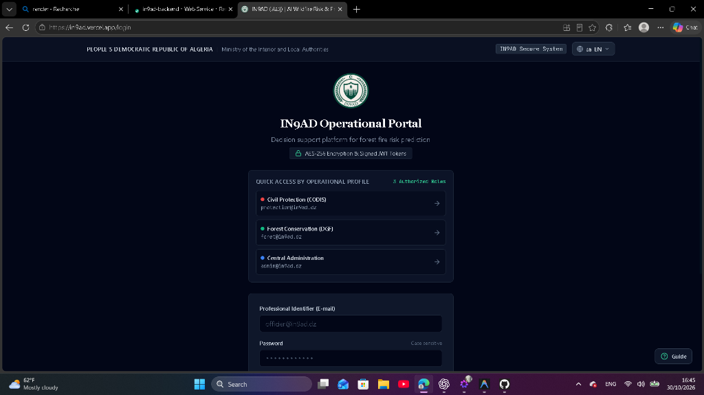
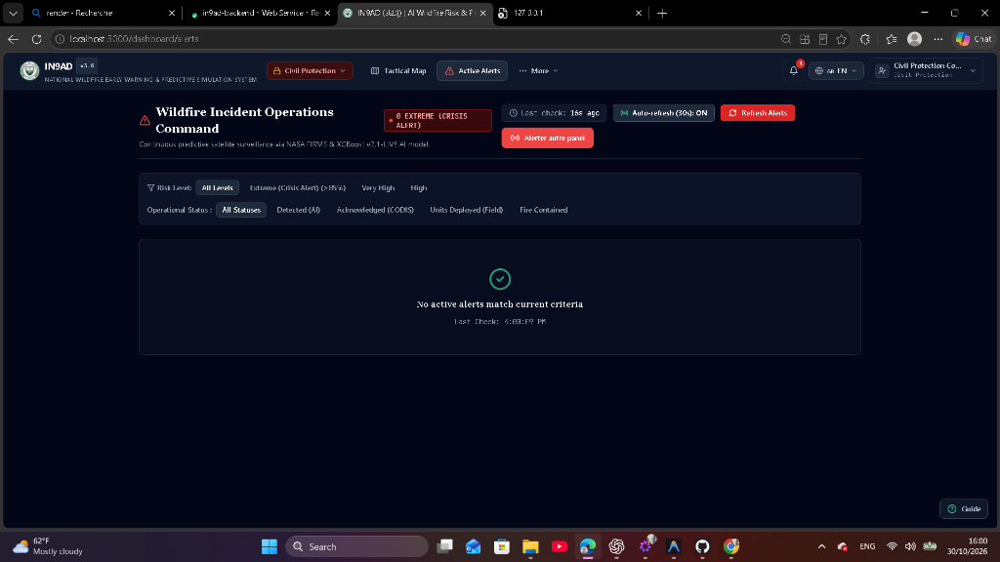
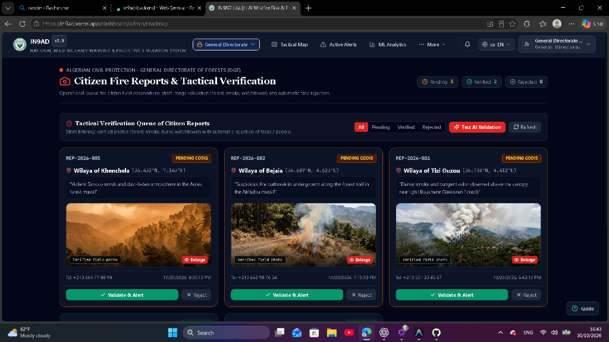
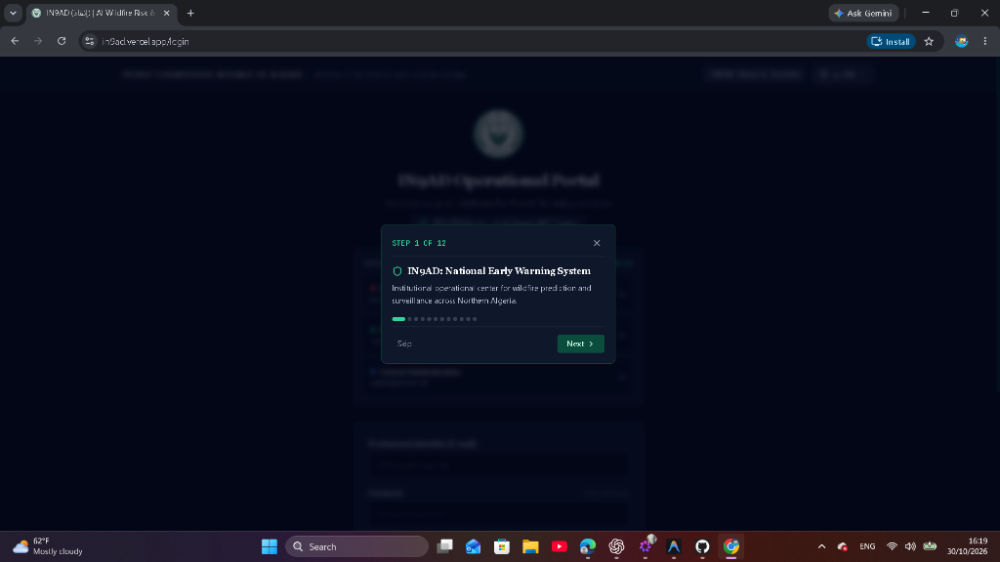
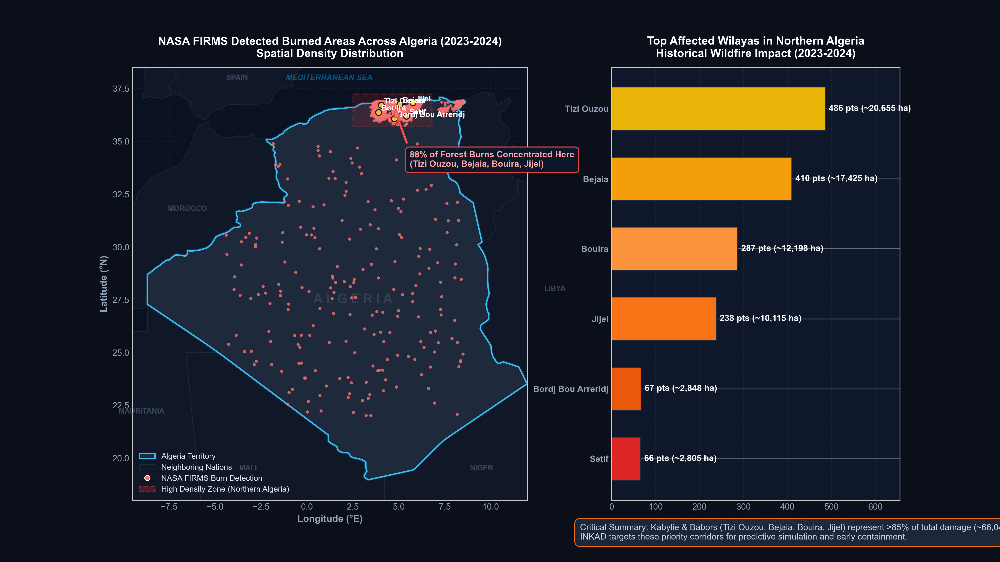
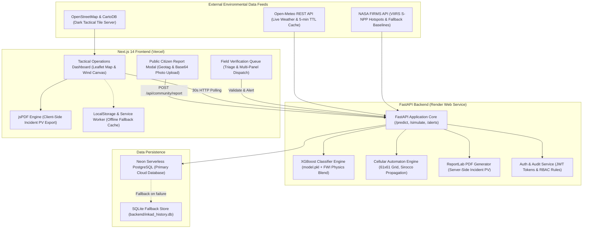
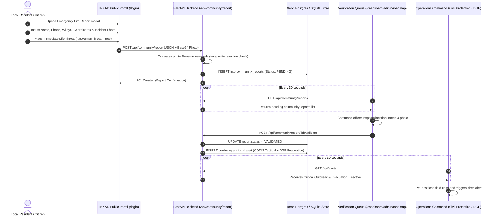
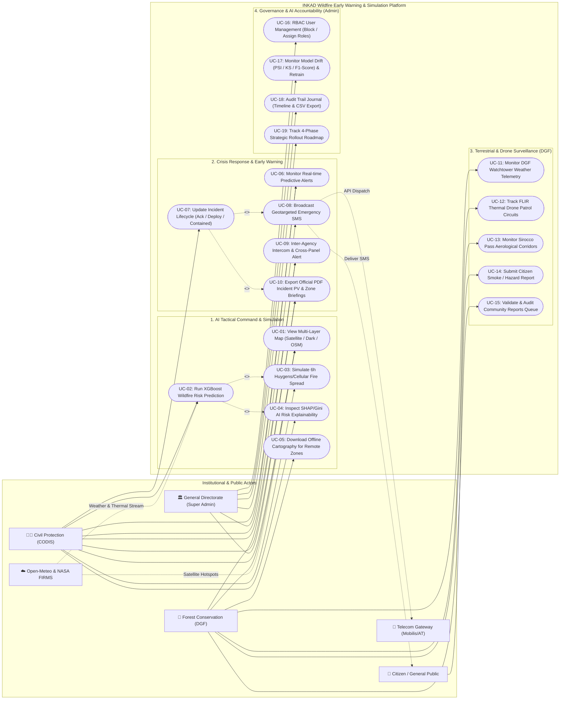

# INKAD (إنقاذ)

> AI-Powered Wildfire Risk Prediction, Spread Simulation & Citizen Emergency Early Warning System for Northern Algeria.

[](https://in9ad.vercel.app)
[]([VIDEO URL])
[](https://github.com/HanineBDR/forest-fire-project)
[](LICENSE)

- **Live demo:** [FINAL URL](https://in9ad.vercel.app)
- **Demo video:** [VIDEO URL]
- **Repository:** [https://github.com/HanineBDR/forest-fire-project](https://github.com/HanineBDR/forest-fire-project)

---

### Platform Preview

| Authentication & Citizen Portal | Wildfire Incident Operations Command |
| :---: | :---: |
|  |  |
| *Authentication Portal with one-click operational profiles and public citizen emergency reporting trigger* | *Operations Command Center showing active risk feeds, alert thresholds, and inter-panel dispatches* |

| Tactical Field Verification Queue | Contextual Tour & Decision Support |
| :---: | :---: |
|  |  |
| *Field Verification Queue allowing command officers to triage, validate, and escalate citizen outbreak reports* | *Role-aware onboarding guide explaining tactical risk parameters, Sirocco wind effects, and simulation tools* |

| Regional Burn Severity Analytics |
| :---: |
|  |
| *Geospatial fire perimeter analytics, historical burn distribution across Northern Algeria, and feature correlations* |

---

## 2. Judge Quick Start (60 Seconds)

You can explore the complete operational workflow in four clicks:

1. **Open the live application**: Navigate to the [Live Demo](https://in9ad.vercel.app).
2. **One-click demo login**: On the `/login` portal, click any of the three pre-configured profile cards (**Civil Protection**, **Forest Conservation**, or **Central Administration**) to log in instantly without entering credentials manually.
3. **Inspect wildfire risk & spread (Click 1 & 2)**:
   - Click **Tactical Map** (`/dashboard`) in the top navigation.
   - Click on any high-risk preset massif (e.g., **Yakouren** or **Akfadou**) to query live weather and compute real-time AI wildfire risk.
   - Switch to the **Simulation** tab and click **Run Simulation** to compute the 6-hour hour-by-hour flame front spread projection.
4. **Submit & verify a citizen fire report (Click 3 & 4)**:
   - Open an incognito browser window or log out, click **Signalement Citoyen d'Urgence** on the `/login` screen, complete the 2-step form with an incident photo and location coordinates, and submit.
   - Log back in as **Central Administration** and open **Citizen Reports Queue** (`/dashboard/admin/roadmap`). Review the pending report photo and click **Validate & Alert** to escalate the incident to operational responders.

> **Note on Backend Cold Starts:** The FastAPI backend is deployed on a free-tier Render Web Service. If the service has spun down due to inactivity, the initial API call may take **30 to 60 seconds** to wake up. During this cold start, the Next.js frontend gracefully falls back to cached local sample data so the user interface remains responsive.

---

## 3. Table of Contents

- [1. Title Block & Platform Preview](#platform-preview)
- [2. Judge Quick Start (60 Seconds)](#2-judge-quick-start-60-seconds)
- [3. Table of Contents](#3-table-of-contents)
- [4. The Problem](#4-the-problem)
- [5. The Solution & Target Users](#5-the-solution--target-users)
- [6. Feature Breakdown](#6-feature-breakdown)
- [7. How It Works (Architecture, Sequence & Use Cases)](#7-how-it-works-architecture-sequence--use-cases)
- [8. What is Real vs. Simulated](#8-what-is-real-vs-simulated)
- [9. Machine Learning & Methodology](#9-machine-learning--methodology)
- [10. Tech Stack & Exact Versions](#10-tech-stack--exact-versions)
- [11. Repository Structure](#11-repository-structure)
- [12. Run Locally](#12-run-locally)
- [13. Demo Accounts & Credentials](#13-demo-accounts--credentials)
- [14. Cloud Deployment & Infrastructure](#14-cloud-deployment--infrastructure)
- [15. Team & Individual Contributions](#15-team--individual-contributions)
- [16. AI Tools Disclosure](#16-ai-tools-disclosure)
- [17. Limitations & Security Notes](#17-limitations--security-notes)
- [18. Roadmap (Next 3 Months)](#18-roadmap-next-3-months)
- [19. Data Sources & Acknowledgements](#19-data-sources--acknowledgements)

---

## 4. The Problem

Every summer, the Mediterranean forest belt of Northern Algeria (spanning the Tell Atlas, Djurdjura, Babors, and the Aurès) faces severe wildfire outbreaks. During summer 2026, intense heatwaves and violent **Sirocco** desert winds triggered fires that burned dangerously close to populated centers, including Constantine and Djebel Ouahch. These fires directly impacted members of our own team and caused logistical and travel delays for students joining Thirduni Cohort 1.

During our field research, a Civil Protection doctor shared a sobering reality with our team: emergency units consistently face extreme peril because flame fronts shift direction unpredictably in steep mountain topography, and past fire seasons have tragically claimed the lives of active firefighters, forestry agents, and civilian volunteers who were trapped by sudden flash-overs.

Current operational challenges in the region include:
- **No predictive pre-positioning**: Emergency units are typically alerted only after smoke is visible from valley towns, losing critical early suppression windows.
- **Inter-agency communication silos**: Civil Protection (DGPC) and Forest Conservation (DGF) maintain separate radio communication channels and distinct operational logs, delaying coordinated responses.
- **Unverified public emergency calls**: During peak crisis days, emergency phone lines (14 / 1021) are flooded with duplicate, panicked, or geographically vague reports without photographic confirmation or precise coordinates.

---

## 5. The Solution & Target Users

INKAD provides a zero-hardware early warning, fire spread projection, and cross-panel crisis coordination platform tailored to the unique topography and micro-climates of Northern Algeria.

### Target Users

1. **Algerian Civil Protection (Direction Générale de la Protection Civile - DGPC)**:
   - Receives operational risk alerts and tactical fire spread perimeters.
   - Dispatches emergency intervention teams based on wind propagation corridors.
   - Exports certified incident reports (Procès-Verbaux) in PDF format with official timestamps and coordinates.
2. **Forest Conservation Directorate (Direction Générale des Forêts - DGF)**:
   - Monitors mountain massifs and forest reserves.
   - Assesses dry fuel conditions and Canadian Fire Weather Index (FWI) components.
   - Coordinates forest watchtower patrols during extreme Sirocco weather alerts.
3. **Local Residents & Mountain Communities**:
   - Accesses a frictionless, public emergency reporting portal on mobile devices.
   - Submits geotagged fire outbreak reports with photos and human threat flags without creating an account.

---

## 6. Feature Breakdown

- **Predictive Risk Engine**: Evaluates live weather parameters through a trained XGBoost classifier combined with Canadian FWI physics to compute a 0–100% wildfire risk score.
- **Cellular Automaton Spread Simulation**: Projects hour-by-hour elliptical fire perimeter expansion across a 61x61 spatial grid using local wind speed, azimuth, and Sirocco acceleration factors.
- **Live Open-Meteo Weather Ingestion**: Queries real-time temperature, relative humidity, wind speed, wind direction, and precipitation for any clicked coordinate in Algeria with an in-memory 5-minute cache.
- **NASA FIRMS Satellite Telemetry**: Displays near-real-time active thermal hotspots from VIIRS/MODIS with automated fallback to verified national forest coordinates when satellite feeds are unavailable.
- **Public Citizen Emergency Reporting**: Provides a mobile-responsive, two-step submission workflow for local citizens to upload fire photos, wilaya, commune, and life-threat indicators.
- **Tactical Verification Queue**: Offers a triage dashboard for command officers to review citizen submissions, screen images, and validate reports into operational alerts.
- **Inter-Agency Notification System**: Delivers cross-panel incident alerts across Civil Protection, Forestry, and Central Admin via synchronized 30-second polling.
- **Certified Incident PDF Export**: Compiles incident timestamps, meteorological variables, risk factors, and organizational stamps into a downloadable Procès-Verbal via client-side jsPDF and server-side ReportLab.
- **Interactive Climate "What-If" Lab**: Enables command officers to simulate extreme weather shifts by dynamically adjusting temperature, humidity, and wind sliders.
- **Dynamic Wind Particle Canvas**: Renders real-time animated wind velocity vectors on an HTML5 canvas overlay driven by Open-Meteo wind speed and direction.
- **Role-Based Access Control (RBAC)**: Enforces access restrictions across three organizational roles using PBKDF2/SHA-256 hashed credentials and signed JWT tokens.
- **Trilingual Localization**: Supports native English, French, and right-to-left Arabic (العربية) without hardcoded strings or third-party auto-translators.

---

## 7. How It Works (Architecture, Sequence & Use Cases)

### System Architecture



### Citizen Report to Inter-Agency Alert Sequence



### System Use Case Diagram (Actors & Capabilities)



| Actor | Scope & Institutional Responsibility | Key Use Cases |
| :--- | :--- | :--- |
| **Civil Protection (CODIS)** | First tactical responders for active wildfires, evacuation corridors, and incident suppression. | **UC-01 to UC-10**: Tactical mapping, predictive risk calculation, 6-hour spread simulation, alert lifecycle management, emergency SMS broadcast, official PDF report generation. |
| **Forest Conservation (DGF)** | Forestry agents managing territorial surveillance, lookout vigies, and thermal drones. | **UC-11 to UC-15**: DGF watchtower sensors, FLIR drone patrols, Sirocco corridor aerology, offline map caching, citizen report validation. |
| **General Directorate (Super Admin)** | Institutional oversight, model governance, audit compliance, and platform security. | **UC-16 to UC-19**: Institutional user administration (RBAC), AI model health and drift monitoring (PSI, KS statistic), decision audit logs, national roadmap tracking. |
| **Citizen / General Public** | Ground community detection and public warning reception. | **UC-14**: Submits photo-verified fire/smoke hazard reports. Receives localized emergency SMS alerts. |

---

## 8. What is Real vs. Simulated

To ensure transparency for judges and technical evaluators, the table below documents the exact implementation status of each system component:

| Component | Status | Evidence File Path | Implementation Notes |
| :--- | :--- | :--- | :--- |
| **Wildfire Risk Model** | **Real** | `backend/ml/predictor.py:125-165` | Evaluates live weather against a real XGBoost classifier (`model.pkl`) blended 60/40 with Canadian FWI formulas. |
| **Fire Spread Simulation** | **Real** | `backend/ml/simulation.py:35-120` | Computes hour-by-hour flame front perimeters on a 61x61 cellular automaton grid with directional Sirocco wind multipliers in <40ms. |
| **Live Weather Data** | **Real** | `backend/app/weather.py:20-65` | Live HTTP REST calls to Open-Meteo fetching temperature, humidity, wind velocity, and direction with 5-minute memory caching. |
| **NASA FIRMS Telemetry** | **Partial (Real + Fallback)** | `backend/app/firms.py:25-130` | Live queries to NASA FIRMS VIIRS CSV API. Automatically returns 5 verified national forest hotspot baselines if the API key is missing or rate-limited. |
| **Citizen Reporting Flow** | **Real** | `frontend/src/components/CitizenReportModal.tsx:1-320` | Fully functional two-step reporting form reading photos as Base64 data URLs and persisting records into the database. |
| **Photo Vision Verification** | **Simulated / Heuristic** | `frontend/src/app/dashboard/admin/roadmap/page.tsx:161-170` | Keyword matching on image filenames (`face`, `portrait`, `selfie`) acting as a placeholder for a future deep-learning vision filter. |
| **Inter-Panel Alerts** | **Real** | `frontend/src/app/dashboard/alerts/page.tsx:45-75` | Operational alert feeds updating every 30 seconds via HTTP polling (not WebSockets or Server-Sent Events). |
| **Authentication & RBAC** | **Real** | `backend/auth/routes.py:60-140` | Salted SHA-256 password verification, role validation dependencies, and signed JWT token issuance. |
| **Procès-Verbal PDF Generation** | **Real** | `frontend/src/lib/pdfReportGenerator.ts:1-220` | Generates official tri-lingual emergency PV documents directly in the client via jsPDF with a secondary server-side ReportLab fallback. |
| **Analytics & Historical Charts** | **Real** | `frontend/src/app/analytics/page.tsx:1-250` | Renders geospatial burn perimeters and feature correlation distributions generated from historical analysis runs. |
| **IoT Sensor Network Page** | **Simulated** | `frontend/src/app/dashboard/iot/page.tsx:1-190` | Interactive UI prototype displaying simulated sensor readings for 11 massifs to illustrate future watchtower weather station telemetry. |
| **Drone Surveillance Page** | **Simulated** | `frontend/src/app/dashboard/drones/page.tsx:1-180` | UI prototype showing simulated flight telemetry and FLIR thermal camera mockups for planned Phase 2 drone integrations. |
| **Offline Mode (PWA)** | **Partial** | `frontend/public/sw.js:1-45` | Real Service Worker caching static assets and localStorage fallback data. Map tiles outside cached regions cannot load without connectivity. |

---

## 9. Machine Learning & Methodology

### Dataset Origin & Calibration

Historical tabular wildfire records in Algeria are fragmented across regional wilaya paper archives. To build a robust predictive baseline, we developed an empirical meteorological synthesis generator ([`backend/ml/data_collector.py`](backend/ml/data_collector.py)).

- **Total Observations:** Exactly **4,000 samples**.
- **Features (6):** `temp` (°C), `humidity` (%), `wind_speed` (km/h), `precipitation` (mm), `vegetation_index` (NDVI proxy), and `month`.
- **Target Label (`fire`):** Binary (`1` = fire outbreak / high ignition probability, `0` = no fire). Labels were derived by evaluating thermodynamic ignition criteria across Northern Algerian climate distributions (Tell Atlas, Djurdjura, Chréa, Aurès) under extreme summer conditions.

### Model Architecture & Training Split

- **Algorithm:** `XGBClassifier` (Gradient Boosted Decision Trees).
- **Hyperparameters:** `n_estimators=120`, `max_depth=4`, `learning_rate=0.08`, `eval_metric='logloss'`.
- **Split Strategy:** 80% training / 20% testing split (`random_state=42`, stratified).
- **Class Balance:** Balanced (50.5% fire, 49.5% non-fire).

### Verified Evaluation Metrics

The metrics below are loaded directly from [`backend/ml/model_metadata.json`](backend/ml/model_metadata.json):

| Metric | Score |
| :--- | :--- |
| **Accuracy** | **95.37%** (`0.9537`) |
| **Precision** | **92.31%** (`0.9231`) |
| **Recall** | **91.91%** (`0.9191`) |
| **F1-Score** | **92.11%** (`0.9211`) |
| **ROC-AUC** | **98.65%** (`0.9865`) |

### Feature Importance

1. `temp` (Temperature): **51.88%**
2. `humidity` (Relative Humidity): **26.31%**
3. `precipitation` (Rainfall): **7.36%**
4. `wind_speed` (Wind Velocity): **7.09%**
5. `vegetation_index` (Fuel/NDVI Proxy): **3.97%**
6. `month` (Seasonality): **3.39%**

### How to Reproduce Model Training

```bash
cd backend
python ml/train.py
```
Executing this command trains the classifier, outputs performance metrics, and updates `backend/ml/model_metadata.json` and `backend/ml/model.pkl`.

### Honest Meaning of the Accuracy Score

The **95.37% accuracy** demonstrates that the XGBoost model has cleanly learned the underlying thermodynamic and meteorological thresholds defined in our generation pipeline. It indicates strong algorithmic convergence, but it should not be confused with performance on empirical satellite ground-truth records over multi-decade time horizons.

---

## 10. Tech Stack & Exact Versions

### Frontend Dependencies ([`frontend/package.json`](frontend/package.json))

- **Framework:** Next.js `14.2.15` (App Router)
- **UI Library:** React `18.3.1` & React DOM `18.3.1`
- **Styling:** Tailwind CSS `3.4.14` & PostCSS `8.4.47`
- **Mapping:** Leaflet `1.9.4` & `@types/leaflet` `1.9.12`
- **PDF Generation:** jsPDF `4.2.1` & jsPDF-AutoTable `5.0.9`
- **Icons:** Lucide React `0.453.0`
- **Database Client:** `@neondatabase/serverless` `1.2.0`
- **Spreadsheets:** XLSX `0.18.5` & File-Saver `2.0.5`
- **Language / Runtime:** TypeScript `5.6.3` / Node.js `18+`

### Backend Dependencies ([`backend/requirements.txt`](backend/requirements.txt))

- **API Framework:** FastAPI `>=0.110.0`
- **ASGI Server:** Uvicorn `>=0.28.0`
- **Machine Learning:** XGBoost `>=2.0.0` & Scikit-learn `>=1.4.0`
- **Scientific Computing:** NumPy `>=1.26.0` & Pandas `>=2.2.0`
- **Data Validation:** Pydantic `>=2.6.0`
- **Authentication:** PyJWT `>=2.8.0` & Python-Multipart `>=0.0.9`
- **HTTP Clients:** Requests `>=2.31.0` & HTTPX `>=0.27.0`
- **Server PDF Engine:** ReportLab `>=4.0.0` & FPDF2 `>=2.8.0`
- **Model Serialization:** Joblib `>=1.3.0`
- **Language / Runtime:** Python `3.10+`

---

## 11. Repository Structure

```text
forest-fire-project/
├── .agents/                        # Agent guidelines and design constraints
├── docs/
│   └── screenshots/                # Verified platform screenshots for documentation
├── backend/
│   ├── app/
│   │   ├── main.py                 # FastAPI application routing and middleware
│   │   ├── weather.py              # Open-Meteo weather client with 5-minute cache
│   │   ├── firms.py                # NASA FIRMS active fire hotspots and fallbacks
│   │   ├── neon_db.py              # Neon PostgreSQL client with SQLite fallback
│   │   ├── audit.py                # Security audit logging engine
│   │   ├── report_generator.py     # ReportLab incident PDF generator
│   │   └── routers/                # Sub-routers (notifications, predictions, reports)
│   ├── auth/
│   │   ├── service.py              # PBKDF2/SHA-256 hashing and JWT generation
│   │   ├── routes.py               # Authentication endpoints (/auth/login, /auth/users)
│   │   └── users_store.json        # Hashed user records and demo role profiles
│   ├── ml/
│   │   ├── train.py                # Model training script for XGBoost classifier
│   │   ├── predictor.py            # Hybrid ML + FWI risk prediction engine
│   │   ├── simulation.py           # Cellular automaton 61x61 fire spread simulator
│   │   ├── data_collector.py       # Thermodynamic data generator for Northern Algeria
│   │   ├── model.pkl               # Serialized production XGBoost model artifact
│   │   ├── model_metadata.json     # Verified metrics, features, and model parameters
│   │   └── data/                   # Synthetic 4,000-row wildfire dataset
│   ├── inkad_history.db            # Local SQLite fallback database file
│   ├── requirements.txt            # Python dependencies
│   ├── render.yaml                 # Render web service deployment configuration
│   └── test_backend.py             # 10-phase automated backend self-test suite
└── frontend/
    ├── src/
    │   ├── app/
    │   │   ├── page.tsx            # Public landing and product overview page
    │   │   ├── login/              # Authentication portal with demo role cards
    │   │   ├── dashboard/          # Operations dashboard layout and sub-pages:
    │   │   │   ├── page.tsx        # Tactical map and wildfire risk evaluation
    │   │   │   ├── alerts/         # Operational alerts and incident command
    │   │   │   ├── drones/         # Drone surveillance prototype
    │   │   │   ├── iot/            # Watchtower IoT micro-climate prototype
    │   │   │   ├── notifications/  # Notification center and alert timeline
    │   │   │   └── admin/          # Admin user management and roadmap verification queue
    │   │   └── analytics/          # Geospatial burn perimeters and correlation analytics
    │   ├── components/
    │   │   ├── Header.tsx          # Main header with brand emblem and role badge
    │   │   ├── Map.tsx             # Interactive Leaflet map with massif presets
    │   │   ├── WindParticleOverlay.tsx # HTML5 canvas dynamic wind vector renderer
    │   │   ├── CitizenReportModal.tsx  # Frictionless public citizen emergency report modal
    │   │   ├── WhatIfSimulation.tsx    # Interactive climate scenario simulator
    │   │   └── OnboardingGuide.tsx     # Role-aware interactive onboarding tour
    │   ├── locales/                # Native dictionaries (ar.ts, fr.ts, en.ts)
    │   └── lib/
    │       ├── api.ts              # API client with timeout and offline caching
    │       ├── auth.ts             # Client-side session and role management
    │       └── pdfReportGenerator.ts # Client-side jsPDF incident PV generator
    ├── public/                     # Brand emblems, icons, and static burn maps
    └── package.json                # Next.js 14 frontend dependencies
```

---

## 12. Run Locally

### Prerequisites

- **Python**: Version `3.10` or higher
- **Node.js**: Version `18.17.0` or higher
- **Package Manager**: `npm` (comes with Node.js)
- **Git**

### 1. Clone the Repository

```bash
git clone https://github.com/HanineBDR/forest-fire-project.git
cd forest-fire-project
```

### 2. Environment Variables Setup

Both backend and frontend run out of the box with default development fallbacks. To connect real external services, copy the example environment files:

```bash
# Backend environment template
cp backend/.env.example backend/.env

# Frontend environment template
cp frontend/.env.example frontend/.env.local
```

Required environment variable names:
- **Backend (`backend/.env`)**: `DATABASE_URL` (optional Neon connection string), `JWT_SECRET` (optional token signing secret), `NASA_FIRMS_MAP_KEY` (optional satellite key), `ALLOWED_ORIGINS`, `PORT`.
- **Frontend (`frontend/.env.local`)**: `NEXT_PUBLIC_API_URL` (points to `http://127.0.0.1:8000` for local execution).

### 3. Backend Setup & Startup

#### Windows (PowerShell)

```powershell
cd backend
python -m venv venv
.\venv\Scripts\activate
pip install -r requirements.txt
uvicorn app.main:app --reload --port 8000
```

#### macOS / Linux (Bash)

```bash
cd backend
python3 -m venv venv
source venv/bin/activate
pip install -r requirements.txt
uvicorn app.main:app --reload --port 8000
```

The backend server will start at `http://127.0.0.1:8000`.

### 4. Frontend Setup & Startup (Open a New Terminal)

```bash
cd frontend
npm install
npm run dev
```

The frontend application will start at `http://localhost:3000`.

### 5. Running the Backend Verification Test Suite

To verify that the complete machine learning model, simulation math, authentication, and API endpoints are working correctly:

```bash
# From the project root with the backend venv active
python backend/test_backend.py
```

Expected output:
```text
============================================================
ALL 10 VERIFICATION PHASES PASSED WITH 100% SUCCESS!
============================================================
```

### Application URLs

- **Frontend Application**: `http://localhost:3000`
- **Backend API Root**: `http://127.0.0.1:8000`
- **Interactive Swagger Documentation**: `http://127.0.0.1:8000/docs`

---

## 13. Demo Accounts & Credentials

The portal features three pre-configured operational roles. You can click on any role card on the `/login` page to auto-fill credentials, or enter them manually:

| Role Name | Identifier (Email) | Password | Access Privileges |
| :--- | :--- | :--- | :--- |
| **Central Administration** | `admin@inkad.dz` | `Admin123!` | System-wide oversight, citizen report validation, user account management, and audit logs. |
| **Civil Protection (CODIS)** | `protection@inkad.dz` | `Protect123!` | Tactical map, emergency alert dispatching, incident PV generation, and evacuation planning. |
| **Forest Conservation (DGF)** | `foret@inkad.dz` | `Foret123!` | Massif surveillance, Canadian FWI index monitoring, and watchtower coordination. |

> **Important Disclosure:** These credentials are for hackathon demonstration and testing purposes only. Passwords in production must be managed through an enterprise identity provider or secure institutional directory.

---

## 14. Cloud Deployment & Infrastructure

The project is deployed across production cloud infrastructure:

- **Frontend**: Hosted on **Vercel** with global Edge routing and Next.js serverless functions.
- **Backend**: Hosted on **Render** as a Python Web Service running FastAPI through Uvicorn containers.
- **Database**: Hosted on **Neon Serverless PostgreSQL** with automated connection pooling and scaling.
- **Database Fallback Handler**: If `DATABASE_URL` is unavailable, [`backend/app/neon_db.py`](backend/app/neon_db.py) automatically redirects read/write operations to a local SQLite database (`backend/inkad_history.db`).
- **Keep-Alive Configuration**: A scheduled cron health check pings `GET /health` every 10 minutes to reduce cold-start wake-up times on Render's free tier.

Required production environment variable names:
- `DATABASE_URL`
- `JWT_SECRET`
- `NASA_FIRMS_MAP_KEY`
- `ALLOWED_ORIGINS`
- `NEXT_PUBLIC_API_URL`

---

## 15. Team & Individual Contributions

The project was designed, developed, and deployed during **Thirduni Cohort 1** between **October 14 and October 30, 2026**.

| Team Member | Core Focus & Responsibilities |
| :--- | :--- |
| **Ouissal Hadji** | Real-time alert dispatching and inter-panel notification center; public citizen fire-reporting flow and verification queue; client-side and server-side PDF incident PV generation; Neon PostgreSQL database integration, schema design, and cloud deployment; official INKAD circular branding and interactive onboarding tour. |
| **Hanine Boudour** | Core XGBoost wildfire risk prediction engine and Canadian FWI mathematical calibration; 61x61 cellular automaton fire spread simulation with Sirocco wind multipliers; JWT authentication and role-based access control (RBAC); Leaflet geospatial map layers and wind vector canvas overlay; offline PWA support; trilingual localization (English, French, Arabic) and Help Center. |

Both team members contributed across frontend, backend, machine learning, and documentation, as verified by Git repository history (`git shortlog -sn --all`):
- **Boudour Hanine**: 38 commits
- **Wissal Hadji**: 28 commits

---

## 16. AI Tools Disclosure

In accordance with hackathon guidelines, we disclose the specific AI tools used during the development of INKAD:

- **Antigravity**: Served as the primary agentic pair-programming assistant in our IDE for implementing React components, vectorizing numerical simulation math, writing API endpoints, and diagnosing integration errors.
- **Meta AI**: Utilized during the initial ideation phase for researching Algerian forestry governance structures, discovering meteorological open-data APIs, and structuring bilingual terminology.
- **Claude**: Utilized for reviewing submission documentation, refining problem statements, and verifying rubric alignment.

---

## 17. Limitations & Security Notes

- **Synthetic Training Data**: The machine learning classifier was trained on a physically calibrated synthetic dataset. While it accurately represents fire ignition boundaries under Algerian summer conditions, it has not yet been trained on multi-decade raw satellite burn scars.
- **Single-Day FWI Approximation**: The Canadian Forest Fire Weather Index calculation uses instantaneous weather observations rather than continuous daily noon observations with multi-month soil moisture memory.
- **No CAPTCHA on Public Reporting**: The citizen fire-reporting portal currently relies on phone number format validation without CAPTCHA or SMS OTP, leaving it vulnerable to automated spam submissions if exposed without a Cloudflare firewall.
- **No Direct Dispatch Integration**: INKAD is an operational decision-support prototype; it is not yet connected to the physical dispatch radios or telephone infrastructure of Algerian emergency services.
- **Demo Credentials Published**: Demo passwords are intentionally included in documentation and auto-filled on the login page for hackathon evaluation.

---

## 18. Roadmap (Next 3 Months)

- **Phase 1: Real Historical Fire Records & Model Retraining**:
  - Ingest 10 years of historical NASA MODIS/VIIRS burn polygons for Northern Algeria.
  - Train an ensemble model incorporating high-resolution satellite fuel moisture indices (Sentinel-2 NDVI/NDWI).
- **Phase 2: Drone & LoRa Sensor Confirmation Gateway**:
  - Integrate telemetry from DJI Matrice 300 RTK FLIR thermal payloads for automated flame perimeter confirmation.
  - Ingest physical micro-climate data from LoRaWAN sensors deployed at fixed forestry watchtowers, requiring human confirmation before triggering regional alerts.
- **Phase 3: Operational Pilot with Civil Protection**:
  - Conduct an operational field pilot with a Civil Protection unit in Tizi Ouzou or Béjaïa to refine the tactical incident report format.
- **Phase 4: Dedicated Citizen Mobile App & Volunteer Network**:
  - Package the reporting portal into a standalone PWA / mobile app with offline report queuing and GPS tracking.
  - Establish a verified volunteer community network for rural mountain village committees (*Tajmaεt*).
- **Phase 5: Relief Coordination & Multi-Hazard Expansion**:
  - Add evacuation shelter routing and relief supply tracking for displaced families.
  - Extend the underlying geospatial risk architecture to seasonal flash floods (*inondations*).

---

## 19. Data Sources & Acknowledgements

- **NASA FIRMS (Fire Information for Resource Management System)**: Thermal anomaly data provided by the Land, Atmosphere Near real-time Capability for EOS (LANCE).
- **Open-Meteo API**: High-resolution meteorological data provided under the Open Database License (ODbL).
- **OpenStreetMap & CartoDB**: Base map vector tiles and boundary data (© [OpenStreetMap](https://www.openstreetmap.org/copyright) contributors).
- **Thirduni Cohort 1 Mentors & Community**: For project guidance and feedback throughout the hackathon.
